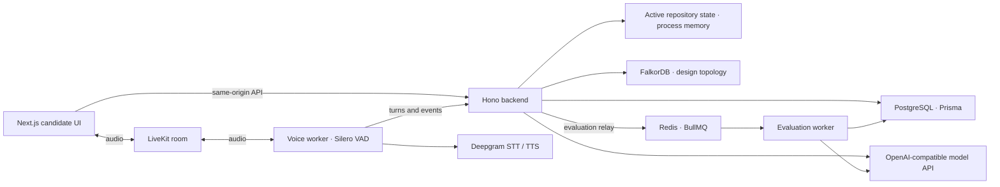

# RepoRound

**Practice explaining the engineering decisions behind your projects.**

[](https://github.com/Manav2209/RepoRound/actions/workflows/ci.yml)


RepoRound is a voice interview practice platform with two modes: discuss decisions in a real GitHub repository, or design a system on a canvas and defend its architecture. Questions adapt to the conversation, and a background worker produces feedback from the candidate's recorded answers.

[Recorded results](#recorded-results) · [Architecture](#architecture) · [Local setup](#local-setup) · [Checks](#checks) · [Documentation](#documentation)

## Interview modes

| Mode              | Duration                      | What the interview explores                                                                                                                                    |
| ----------------- | ----------------------------- | -------------------------------------------------------------------------------------------------------------------------------------------------------------- |
| **Repository**    | 15 minutes                    | Requirements, chosen approaches, plausible alternatives and consequences, grounded in source at a pinned commit. Up to four main questions and two follow-ups. |
| **System Design** | 30 minutes, including drawing | One of ten scoped problems, a submitted architecture, and three substantive questions: the core flow, a technical decision and a failure scenario.             |

Repository preparation samples implementation across services, follows a bounded set of local imports, and prepares questions with source excerpts and assessment criteria. The interviewer briefly summarizes the project, then discusses its decisions without assuming personal ownership of every choice.

System Design snapshots are immutable revisions stored in PostgreSQL and projected into FalkorDB. Candidates can revise their diagram at silent UI checkpoints. Asking to repeat a question replays it without scoring another answer or consuming a question slot.

Results include category feedback, strengths, weaknesses, supporting evidence and coverage. Short or incomplete interviews can produce an **insufficient evidence** result rather than an invented score.

## Recorded results

These development measurements were recorded on **18 November 2026**. Raw samples and methodology are checked into [`spec/benchmarks`](spec/benchmarks).

| Repository backend measurement                       | Before  | After      | Evidence                                            |
| ---------------------------------------------------- | ------- | ---------- | --------------------------------------------------- |
| Median turn processing, live model                   | 8.92 s  | **2.87 s** | Six scripted turns per version                      |
| p95 turn processing, live model                      | 12.12 s | **4.39 s** | Same small development comparison                   |
| Model requests per normal answer                     | 2       | **1**      | Separate assessment/generation → combined request   |
| SQL statements per active turn, immediate-model stub | 26–27   | **0**      | Six turns per version; isolates database/state work |

The [before](spec/benchmarks/repository-live-before.json) and [after](spec/benchmarks/repository-live-after.json) runs measure backend processing; they exclude STT, TTS, browser playback, HTTP round trips and the intentional startup wait. The baseline recorded two assessment-schema failures; the after run recorded none. These measurements predate the latest decision-question prompts and need to be rerun for that version.

Other recorded checks:

- **System Design:** ten scripted rounds and 30 answers; backend median **1.98 s**, p95 **2.68 s**. All ten rounds produced reports and passed repeat, checkpoint and raw-cleanup checks. [Run data](spec/benchmarks/system-design-controlled.json)
- **Live voice smoke:** one synthetic spoken answer through LiveKit, real STT, the configured model and TTS; **6.08 s** from candidate audio-source playout end to first received non-silent reply audio. Report generation and cleanup passed. This is one sample, not a voice p95 or browser-audible measurement. [Run data](spec/benchmarks/repository-voice-smoke.json)
- **Latest recorded local checks:** 183 passing tests, with 43 integration cases skipped in that default run; a separate targeted PostgreSQL run passed 23 tests. Backend lint and type checks passed.

A reliable end-to-end voice p95 and human-rated question/evaluation quality remain unmeasured. [Measurement details, commands and limits](docs/measurements.md)

## Architecture



**The backend owns interview progression.** Models assess answers and propose questions; application policy controls objectives, deadlines, repeats and state changes. The voice worker speaks approved question text.

1. **Prepare:** retrieve a repository at a pinned commit or accept an architecture snapshot. Prepare the relevant evidence and question intents.
2. **Discuss:** stream speech through LiveKit. A repository answer uses one combined model request, local policy checks and prepared fallbacks. System Design uses one assessment request and its question bank.
3. **Evaluate:** save the available repository transcript and final state before evaluation. Durable PostgreSQL intents are relayed to BullMQ; a separate worker writes the report.
4. **Retain useful evidence:** keep account-owned reports and numeric operational summaries after raw-interview cleanup.

Default repository sessions keep active context, transcript and state in one backend process. A disconnect or lost process memory requires a new interview; a crash can lose unflushed turns. System Design retains durable state and its reconnect policy. Memory mode requires one backend owner per active session. [Storage, recovery and graph details](docs/architecture.md)

### Repository layout

| Path                                               | Responsibility                                                                                |
| -------------------------------------------------- | --------------------------------------------------------------------------------------------- |
| [`apps/web`](apps/web)                             | Next.js / React practice flow, voice room, diagram canvas and results                         |
| [`apps/backend`](apps/backend)                     | Hono API, Better Auth, repository analysis, interview policy, graph integration and job relay |
| [`apps/voice-agent`](apps/voice-agent)             | LiveKit worker, Silero turn detection, streaming STT/TTS, cancellation and voice telemetry    |
| [`apps/evaluation-worker`](apps/evaluation-worker) | BullMQ consumer for asynchronous evaluation                                                   |
| [`packages/db`](packages/db)                       | Prisma schema, migrations and shared database client                                          |
| [`packages/providers`](packages/providers)         | Voice and model provider configuration                                                        |
| [`packages/types`](packages/types)                 | Shared voice/backend contracts                                                                |
| [`spec`](spec)                                     | Design decisions, research, benchmark artifacts and implementation specs                      |

## Local setup

### 1. Prerequisites

- **Bun 1.4.2** and **Node.js 24+**.
- **Docker** for local PostgreSQL, Redis and FalkorDB, or equivalent reachable services.
- A **LiveKit** project or reachable self-hosted server, a **Deepgram** key, and an **OpenAI-compatible model endpoint** with credentials.

The app makes real provider requests during repository preparation and voice interviews. Provider credentials are required to exercise those flows.

### 2. Install and create environment files

```bash
git clone https://github.com/Manav2209/RepoRound.git
cd RepoRound
bun install --frozen-lockfile

cp apps/backend/.env.example apps/backend/.env
cp apps/voice-agent/.env.example apps/voice-agent/.env
cp apps/evaluation-worker/.env.example apps/evaluation-worker/.env
cp apps/web/.env.example apps/web/.env
cp packages/db/.env.example packages/db/.env
```

In PowerShell, use `Copy-Item` in place of `cp` if your shell does not provide that alias. Fill in the copied files before starting the services.

### 3. Start local dependencies

For a fresh local setup, these containers match the ports and database credentials in the environment examples. Reuse existing services instead if those ports are already occupied.

```bash
docker run -d --name reporound-postgres -p 127.0.0.1:5432:5432 -e POSTGRES_USER=ai_interview -e POSTGRES_PASSWORD=ai_interview -e POSTGRES_DB=ai_interview -v reporound-postgres:/var/lib/postgresql/data postgres:17-alpine
docker run -d --name reporound-redis -p 127.0.0.1:6380:6379 -v reporound-redis:/data redis:7-alpine redis-server --appendonly yes --maxmemory-policy noeviction
docker run -d --name reporound-falkor -p 127.0.0.1:6379:6379 falkordb/falkordb:latest
```

Redis on **6380** carries BullMQ jobs. FalkorDB on **6379** stores graph projections; keep their endpoints distinct. These example credentials are for local development. For managed PostgreSQL, use the provider's required TLS configuration.

### 4. Configure shared settings

| Setting                                                      | Configure in                                                                                                                                                  |
| ------------------------------------------------------------ | ------------------------------------------------------------------------------------------------------------------------------------------------------------- |
| `DATABASE_URL`                                               | Backend, evaluation worker and `packages/db`; all must point to the same database. Prefer a direct endpoint for migrations; runtime clients may use a pooler. |
| `AI_ROUTER_BASE_URL`, `AI_ROUTER_API_KEY`, `AI_ROUTER_MODEL` | Backend, voice worker and evaluation worker                                                                                                                   |
| `LIVEKIT_URL`, `LIVEKIT_API_KEY`, `LIVEKIT_API_SECRET`       | Backend and voice worker; use the same LiveKit project                                                                                                        |
| `DEEPGRAM_API_KEY`                                           | Voice worker                                                                                                                                                  |
| `INTERNAL_API_TOKEN`                                         | Backend and voice worker; use the same secret                                                                                                                 |
| `BULLMQ_REDIS_URL`                                           | Backend and evaluation worker; local default `redis://localhost:6380`                                                                                         |
| `FALKORDB_HOST`, `FALKORDB_PORT`, `FALKORDB_GRAPH`           | Backend; local defaults `localhost`, `6379`, `ai_interviewer`                                                                                                 |
| `BETTER_AUTH_URL`, `BETTER_AUTH_SECRET`                      | Backend; local origin `http://localhost:3000`, secret of at least 32 random characters                                                                        |
| `BACKEND_URL`                                                | Web app; local default `http://localhost:8080`                                                                                                                |

Keep `CORS_ALLOWED_ORIGINS` aligned with the frontend origin. `BETTER_AUTH_URL` is the public frontend URL, including when the backend runs on a different port. The examples describe optional OAuth, email, trace export and cost-estimation settings.

Generate separate random values for `BETTER_AUTH_SECRET` and `INTERNAL_API_TOKEN` with:

```bash
bun -e "console.log(require('node:crypto').randomBytes(32).toString('hex'))"
```

For local console-only email, comment out or remove `RESEND_API_KEY` and `AUTH_EMAIL_REPLY_TO` when unused. Optional settings must be omitted when unset; an empty value can fail configuration validation. Production email requires Resend and a configured sender.

Default repository settings are `GITHUB_ACTIVE_STORAGE=memory`, `GITHUB_TURN_MODE=combined` and `REPOSITORY_CONTEXT_MODE=diverse`. See [the development guide](docs/development.md#setup) for recovery behavior and comparison modes.

### 5. Generate the client and apply migrations

From the repository root:

```bash
bun run db:generate
bun run db:migrate:deploy
bun run db:migrate:status
```

The Prisma CLI uses `packages/db/.env`. These commands apply the checked-in schema to the database you configured. Application containers do not run migrations automatically. For an existing pre-auth deployment, read the [migration note](docs/development.md#setup) before upgrading.

### 6. Run and test an interview

```bash
bun run dev --ui=stream
```

This starts the **web app, backend, voice worker and evaluation worker**. The terminal streams logs with service prefixes.

1. Open [localhost:3000](http://localhost:3000). Backend health is available at [localhost:8080/health](http://localhost:8080/health).
2. Create an account and verify its email. Without local Resend credentials, verification links appear in the **backend terminal**.
3. Choose a public GitHub repository or a System Design problem. Let preparation finish, then allow microphone access and start.
4. End the interview and wait for the evaluation worker to produce the report.

If a report stays pending, check the evaluation worker and its Redis/database configuration. If voice never connects, check worker registration, matching LiveKit credentials and `BACKEND_BASE_URL`. For containers, a host service is reached through `host.docker.internal` on Docker Desktop. [More setup and Docker details](docs/development.md)

## Checks

```bash
bun run lint
bun run check-types
bun test apps/backend/src apps/voice-agent/src apps/web/lib
bun run build
```

Database integration tests are opt-in. Run them against a **disposable migrated test database**; graph and queue transport tests also need their corresponding services. Instructions and benchmark commands are in [development](docs/development.md#checks) and [measurements](docs/measurements.md#reproduce-the-backend-measurements).

CI runs code checks and builds four application images. Main pushes publish commit-tagged images when registry credentials are configured. EC2 deployment is a separate workflow, with manual deployment by default and automatic deployment available as an opt-in. [CI guide](docs/ci-practice.md) · [EC2 guide](docs/ec2-deployment.md)

## Metrics and current limits

Authenticated users can read their recent operational history at `GET /api/v1/metrics`: stage timings, p50/p95, sample counts, failures, cancellations, retries, model tokens, audio usage and source-reference coverage. Numeric summaries survive raw cleanup and are removed with the report or account.

- `voice.response_start` measures the worker entering its speaking state. Browser-audible latency needs a separate measurement.
- The intentional **10-second startup wait** is recorded separately and subtracted only from adjusted startup. Ordinary turn durations do not subtract ten seconds.
- The repository index is partial and bounded. Source references and matching quotes establish provenance; question relevance and assessment correctness still need human review.
- Cost estimates need configured provider rates and complete usage. A missing estimate is unknown cost.

## Documentation

- [Architecture and runtime reference](docs/architecture.md): state, recovery, graph algorithms, evaluation and access controls.
- [Development and operations](docs/development.md): detailed environment setup, Docker builds, observability and integration tests.
- [Recorded measurements](docs/measurements.md): raw evidence, sample sizes, reproduction commands and interpretation.
- [Repository decision interview spec](spec/repository-decision-interview-spec.md) and [generated question preview](spec/repository-decision-question-preview.json).
- [System Design question research](spec/system-design-question-bank-research.md).
- [Latency improvement spec](spec/interview-latency-improvement-spec.md).
